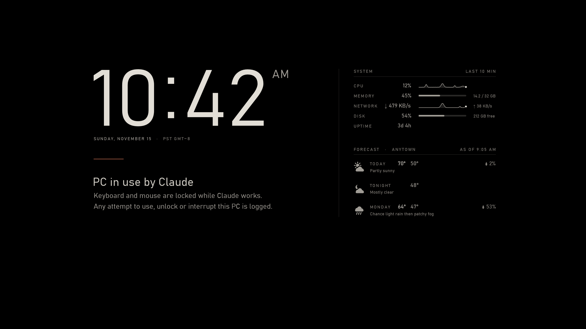
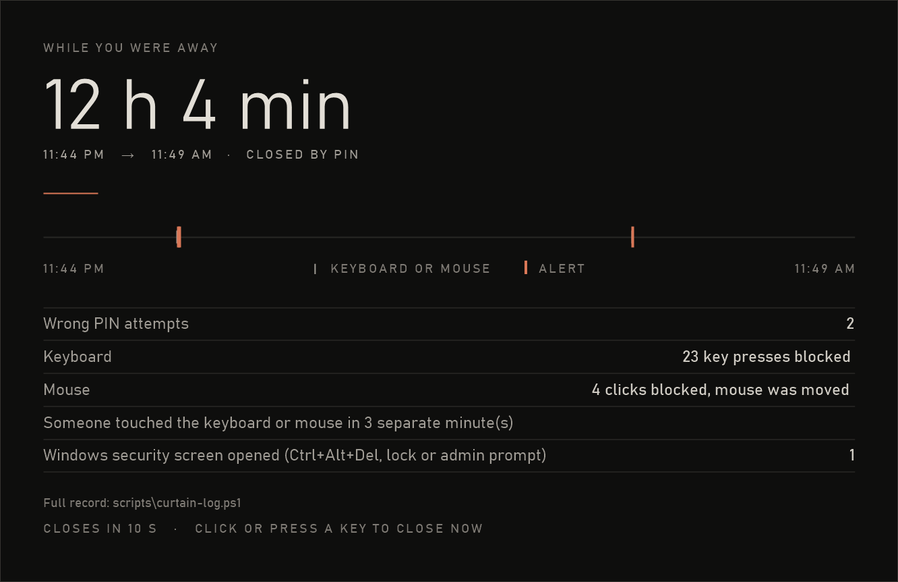

# Privacy curtain

A black screen that covers every monitor and blocks the physical keyboard and mouse, while automated
(injected) clicks, typing and screenshots keep working underneath. It's for hiding an automated session on
a machine you share a room with, without taking the machine away from yourself.



Awareness, not lockout: it counts and logs every blocked key press, click and escape attempt, can ping your
phone while someone is at the keyboard, and shows a "While you were away" summary when you unlock. The
screen itself is designed as carefully as the safety: see [Design](#design).

No installs, no administrator rights, nothing that survives a reboot. It compiles with the C# compiler that
already ships inside Windows (.NET Framework 4).

> **This is not a security tool.** It hides a screen and swallows stray input; it does not lock the machine.
> Read [Limitations](#limitations) before relying on it.

## Requirements

- Windows 10 version 2004 (build 19041) or later, or Windows 11. The capture-exclusion it relies on
  (`SetWindowDisplayAffinity(WDA_EXCLUDEFROMCAPTURE)`) needs that version.
- The in-box .NET Framework 4 compiler (`csc.exe` under `%WINDIR%\Microsoft.NET\Framework64\v4.0.30319`).
  Present on a normal Windows install. Nothing is downloaded or installed.

## Build

From the repository root:

```powershell
.\scripts\build.ps1            # produces bin\ClaudeCurtain.exe
.\scripts\build.ps1 -Tests     # also builds the test helper
```

`bin\` is build output and is gitignored.

## Use

```powershell
.\scripts\curtain-setpin.ps1              # once, at the PC: set the unlock PIN
.\scripts\curtain-on.ps1                  # 12 hours (the default)
.\scripts\curtain-on.ps1 -Hours 3
.\scripts\curtain-on.ps1 -Minutes 2       # handy for a first test
.\scripts\curtain-off.ps1                 # remote unlock (from another shell / remote session)
.\scripts\curtain-status.ps1 -Log 20
```

The curtain refuses to start until a PIN is set. The PIN is typed into a dialog on the PC's screen; only a
salted PBKDF2-HMAC-SHA256 hash is kept, in `local\pin.hash` (gitignored). A fresh random salt is generated
per machine the first time you set a PIN; nothing about the PIN is ever committed. Timer: default 12
hours, at most 24 (`-Hours 24` for a full day).

> **Tip: make a desktop shortcut.** Day to day, the easiest way in is a double-click. Run this once in
> PowerShell from the repository root:
>
> ```powershell
> $s = (New-Object -ComObject WScript.Shell).CreateShortcut("$([Environment]::GetFolderPath('Desktop'))\Privacy Curtain.lnk")
> $s.TargetPath = "$env:WINDIR\System32\WindowsPowerShell\v1.0\powershell.exe"
> $s.Arguments = "-NoProfile -ExecutionPolicy Bypass -WindowStyle Hidden -File `"$PWD\scripts\curtain-launch.ps1`""
> $s.WorkingDirectory = "$PWD"
> $s.IconLocation = "$env:WINDIR\System32\imageres.dll,-59"   # a padlock
> $s.Save()
> ```
>
> Or by hand: right-click the desktop > New > Shortcut, and paste
> `powershell.exe -NoProfile -ExecutionPolicy Bypass -WindowStyle Hidden -File "<repo>\scripts\curtain-launch.ps1"`.
>
> The shortcut asks how many hours (prefilled 12, any value 1–24) and raises the curtain with no console
> window. If [Claude Code](https://claude.com/claude-code) is installed, it first starts a Remote Control
> session named `privacy-curtain` in Windows Terminal, so the PC stays reachable from your phone or another
> computer while the screen is dark (for example to run `curtain-off.ps1`). That part is best-effort: if it
> cannot start, the curtain still goes up.

## Ways back in

Any one of these is enough, and they do not depend on each other.

1. **PIN.** Type the digits, then Enter, on the physical keyboard. Backspace corrects, Esc clears. Five
   wrong tries in a row cost a 30-second pause, never more.
2. **`curtain-off.ps1`.** Asks the curtain to close, then kills the process if needed. A standalone script
   that loads nothing else, so it works even if the rest of the tool is broken.
3. **The timer.** Two independent clocks (wall time and system uptime); either one ends it. Time asleep
   counts.
4. **The watchdog.** A second process ends the curtain if it overruns its timer by a few seconds or stops
   responding.
5. **Ctrl+Alt+Del.** Never intercepted. From that screen: Sign out, or the power icon.
6. **The power button.** Not keyboard input, so it cannot be blocked. The curtain closes the instant Windows
   asks apps to end the session, on a listener that does not depend on its window thread, so it can't hold
   up a shutdown. (Set the button to *Shut down* under Power Options if you want a one-press exit.)
7. **Anything that ends the process.** The block exists only while `ClaudeCurtain.exe` is alive:
   `taskkill /F /IM ClaudeCurtain.exe`, a crash, or a reboot.

When anything looks wrong (a stuck thread, a lost watchdog, a hook error) the curtain closes itself. It
never changes sleep settings, Windows sign-in, the registry, or startup. The design rule throughout: being
open by mistake costs some privacy; being stuck closed would cost you the use of your own PC, so every
fault fails open.

## Staying awake and unlocked

While the curtain is up it holds a keep-awake request (`SetThreadExecutionState`: system + display). That
puts sleep, hibernate, display-off and the screen saver on hold, because any of them can end at the Windows
lock screen where the automated session can't work. It is a request held by the process, not a settings
change: it ends the moment the curtain closes or its process dies, and your normal settings apply again.

It does **not** override two things that can still lock the machine behind the curtain. Check these
yourself before relying on it:

- **A machine inactivity limit** (the `InactivityTimeoutSecs` policy), if your organization sets one.
- **Dynamic Lock** (locks when a paired phone walks away), under Settings > Accounts > Sign-in options.

`curtain-on.ps1` also lists any administrator window that is open when it starts, because physical keys can
reach those behind the curtain (see [Limitations](#limitations)).

## Event log and "While you were away"

The curtain says on screen that attempts to use, unlock or interrupt the PC are logged, and
`local\events.log` (gitignored, capped at 1 MB, oldest part dropped) is that log. It is written on events
only, plus at most one line a minute. It holds counts, never PIN digits and never which keys were pressed.

```powershell
.\scripts\curtain-log.ps1                 # last 40 events
.\scripts\curtain-log.ps1 -NoHeartbeat -Summary
```

Recorded, each with a timestamp: start and stop (and how it stopped); wrong-PIN attempts as a count;
physical key/mouse use while blocked as counts per minute; the Windows security screen opening and closing;
Task Manager coming to the front and any administrator window taking focus; session lock/unlock and Remote
Desktop; network drops and returns; the process being killed; and, at the next start, an earlier curtain
that ended with no record (power cut, crash, kill).

On a PIN unlock a "While you were away" window shows how long you were gone, a timeline of the session
(short neutral ticks for minutes when someone was at the keyboard or mouse, taller accent ticks for
alerts such as a wrong PIN or the security screen), and the totals as a table. It never takes focus and
closes itself after 10 seconds. It sizes itself to its content and the screen: a long summary first flows
its table into more columns, then steps its text down, until it fits. `curtain-off.ps1` prints the same
summary as text.

 The closing time is not shown on
screen; `curtain-on.ps1` and `curtain-status.ps1` print it.

**How long logs are kept.** By size, not by date, so they can never grow past a fixed amount. All of
them together stay under about 1.8 MB:

| File (in `local\`) | Cap | Roughly how much history |
|---|---|---|
| `events.log` | 1 MB, trimmed to the newest 600 KB | about 10 days of round-the-clock curtain, far longer with normal use |
| `curtain.log` (diagnostics) | 512 KB, trimmed to the newest 128 KB | weeks |
| `alerts.log` | 256 KB, trimmed to the newest 160 KB | thousands of alerts |
| `last-summary.txt`, `last-summary-timeline.txt`, `last-exit.json`, `weather.txt` | one small file each, overwritten (the timeline holds at most 5,000 moments, about 60 KB) | the last run only |
| `test\report-*.txt` | the 10 newest are kept | the last 10 test runs |

Your own unlock is not counted as someone at the keyboard. The key presses of the PIN entry that unlocked
(its digits, any Backspace corrections, and Enter) are left out of every count: the summary, the event log
and the "all clear" alert. That also keeps the PIN's length out of them. Wrong attempts still count.

## Alerts (optional)

The curtain can make interference *visible* without blocking anything. It sends an alert through an
external notify hook (a PowerShell script you point it at, for example one that pushes to your phone), on
top of the event-log line, and records it in `local\alerts.log`, when:

- **someone uses the blocked keyboard or mouse.** The alert says how many key presses and clicks were
  blocked in the last minute (counts only, never which keys). Sustained use pings again each minute.
- **the Windows security screen opens** (Ctrl+Alt+Del, the lock screen or an administrator prompt).
- **Task Manager comes to the front**, or **an administrator window takes focus**.

Details:

- The hook is optional. With none configured, alerts are logged only. Point it at your own script with
  `--notify-hook` (the default looks for `%USERPROFILE%\.claude\hooks\notify.ps1` and is skipped if absent).
- Repeat alerts of the same kind within 30 seconds collapse into one; the event log still counts every
  repeat. One "all clear" with the totals is sent when the curtain closes cleanly (PIN, `curtain-off`,
  timer, Windows shutdown). After the security screen closes, the curtain re-asserts itself to
  the foreground (without stealing focus) so the black screen returns on top.
- Nothing here blocks or changes anything; a failed alert never affects the curtain.

## Design

A screen that stays up for hours in a shared room should be calm, legible from across it, and honest
about what it is doing. Everything on it comes from one proportional system built on the golden ratio,
φ ≈ 1.618, and the curtain can draw that system on top of itself:


- **Grid.** On a landscape screen the composition is two columns in the ratio φ : 1: the time and the
  message on the left, live data on the right, a hairline between them. The data column's first label
  sits on the same line as the top of the digits. On a portrait screen the data moves under the message.
  The composition rests on the golden section of the screen: the space above it and below it are 1 : φ.
- **Type.** One family, Bahnschrift, a DIN design that ships with Windows, from Light for the clock to
  Regular for data. Every size is the clock size divided by a power of φ, and every gap is a step on the
  same scale. Large type is aligned by its ink rather than its side bearing, the colon is lifted to the
  optical centre of the digits, AM/PM hangs small at cap height, and small capitals are letter-spaced.
  Forecast text is set in sentence case.
- **Data.** CPU and download rate are ten-minute sparklines with the newest reading at the right and a dot
  on it; memory and disk are proportion bars. CPU is drawn on a fixed 0–100% scale, so a quiet machine
  looks quiet. Every value is also printed as text beside its graphic, so nothing depends on reading a
  chart. The forecast is a table with weather symbols drawn in code (sun, moon, cloud, partly cloudy,
  rain, storm, snow, fog, wind) and a droplet beside the chance of rain.
- **Colour.** Warm neutrals in four text tones and one accent, the short terracotta rule. The self-tests
  compute each tone's contrast on black: every text tone meets WCAG AA (the faintest labels are 4.9 : 1)
  and body text and values meet AAA (7.7 : 1). Overnight (10:30 PM to 6:30 AM, with hour-long ramps) the
  clock dims to 70% so it glows less in a dark room, and still meets AAA.
- **Motion.** The composition is rendered once into an image, again only when something on it changes
  (about 30 to 50 ms), and moved as one rigid piece a whole pixel at a time, so lines never shimmer
  against each other. It fades in when the curtain rises and cross-fades when the minute turns. The
  accent rule breathes slowly while the curtain is up, a quiet sign that the PC is at work. Typed PIN dots
  ease in, and a wrong PIN shakes them before they fade and the note appears. The screen repaints at about
  60 frames a second only while one of these short animations plays, and five times a second otherwise.
- **Drift.** Against burn-in, the composition wanders within 5% of its resting point: one sweep across
  every 5 minutes and one sweep down every 5 × φ ≈ 8.1 minutes. Because φ is irrational the path never
  repeats, so over the hours it covers its area evenly instead of retracing one figure:


The curtain hides itself from screenshots by design, so every image here is rendered by the curtain's own
preview mode:

```powershell
.\bin\ClaudeCurtain.exe --render-preview "$env:TEMP\curtain.png" --test-screen 2560x1440 --test-state typing
.\bin\ClaudeCurtain.exe --render-preview "$env:TEMP\construction.png" --overlay
.\bin\ClaudeCurtain.exe --render-preview "$env:TEMP\summary.png" --test-state summary
.\bin\ClaudeCurtain.exe --render-drift "$env:TEMP\drift.png"
```

`--test-state` is one of idle, typing, wrong, shake, cooldown, admin, bright, night, summary;
`--preview-seconds N` shows the drift position N seconds in.

## On-screen info

The data column:

- **Machine stats**, live from inside the curtain (sampled once a second, no performance counters, no
  admin): CPU busy %, memory used, download and upload rates, used share of the system drive, and system
  uptime, with ten minutes of history kept in memory for the sparklines.
- **A short local forecast.** Set your location in `config.json` (copy `config.example.json`):

  ```json
  { "grid": "ABC/12,34", "place": "Your City", "wuApiKey": "" }
  ```

  Find your `grid` at `https://api.weather.gov/points/<lat>,<lon>` (read `gridId`, `gridX`, `gridY`).
  `curtain-weather.ps1` then writes three days to `local\weather.txt`, and the curtain reads that file and
  refreshes whenever it changes. `curtain-on.ps1` runs the fetch in the background at start; you can also
  run it any time:

  ```powershell
  .\scripts\curtain-weather.ps1
  ```

  The source is the US National Weather Service (`api.weather.gov`): keyless, no account, no install. It is
  best-effort: a lost network shows no forecast rather than an error, and anything older than a day is
  dropped. The User-Agent sent to NWS is a generic client name. Weather Underground's forecast API now needs
  a paid key, so it is not the default; `config.json` has a `wuApiKey` slot for where one would go.

Everything here is read-only and isolated: a failed reading shows `--`, and nothing in it can hold up the
curtain or a shutdown.

## Limitations

Please read these before relying on the curtain.

- **It is not a security boundary.** It is a personal privacy curtain: it hides the screen and swallows
  stray keyboard and mouse input from someone walking up. It does not lock the machine. To actually secure
  the PC, lock Windows.
- **The PIN is not a real lock.** It is a convenience for dismissing the curtain at the keyboard. It is only
  lightly rate-limited (a 30-second pause after five wrong tries) with no lasting lockout, so it will not
  withstand determined guessing. And anyone who can reach the running process can simply close it (Task
  Manager, `taskkill`, Ctrl+Alt+Del > Sign out, or the power button). That is deliberate, so you can never
  be locked out of your own machine.
- **Injected input is trusted.** The curtain blocks physical keyboard and mouse but deliberately lets
  *injected* (synthetic) input through, so an automation tool can keep driving the machine underneath. This
  means anyone or anything that can inject input — including remote-control software — operates the machine
  through the curtain. Treat the curtain as hiding a session you trust, not as walling one off.
- **Administrator windows.** Without admin rights, Windows hides input aimed at an elevated window (Task
  Manager, an admin shell) from the hooks, so physical keys reach that window. While one has focus the
  curtain says so and switches PIN entry to registered hotkeys. If the PIN seems dead, press the Windows key
  first.
- **Things Windows draws above every app** can show over the curtain: toast notifications, the Start menu,
  Alt+Tab, the volume popup. Turn on Focus Assist if toasts matter. The mouse pointer also stays visible.
- **Games.** Apps that read raw input (most games) and game controllers are not blocked. Not tested with
  exclusive-fullscreen games.

## Tests

```powershell
.\scripts\test-curtain.ps1            # lifecycle, works while locked
.\scripts\test-curtain.ps1 -Desktop   # screenshots and injected input; run with the PC unlocked
```

They use a throwaway PIN in `local\test` and never touch the real one, and they never call your notify
hook. The self-tests (~86 checks, including PIN hashing/entry rules, which key presses belong to your own
unlock, the time-zone label, the stats sampler, weather-file reading, and the design: every state rendered
at 720p, 1080p, 16:10, 1440p, ultrawide and portrait, fitting the screen, the columns exactly φ : 1,
staying on screen through 8 hours of drift, every text tone's WCAG contrast, and the animations starting
and settling) and the full lifecycle suite (100+ checks: a screenshot seeing the
desktop through the curtain, injected clicks and typing passing through, simulated shutdown, every hang
being recovered, the keep-awake request appearing with the curtain and vanishing with it, the alerts, the
re-assert, the event log/summary, and the summary window laid out at 720p, 1080p and 1440p with nothing
clipped) both pass. The on-screen info
panel and real physical key presses are not script-testable (the curtain is excluded from screen capture by
design); a person-at-the-PC checklist is in the lifecycle test's output.

`-Stage display-off` is a stronger keep-awake proof kept out of the default run, because it changes a
display-timeout setting for about two minutes and then restores it. Nobody should touch the PC while it
runs.

## Layout

- `src/` — C# source, compiled by `scripts/build.ps1` with the in-box Windows `csc.exe` into `bin/`
  (ignored).
- `scripts/` — the PowerShell entry points (on, off, launch, set-pin, status, log, weather, build, test).
- `tests/` — the test helper used by `test-curtain.ps1`.
- `local/` (ignored) — the PIN hash, logs, run state, and the cached forecast.

## Colophon

Set in Bahnschrift (Microsoft, after DIN 1451). Grid, type scale, margins and drift all derive from the
golden ratio. Drawn with GDI+ from the C# compiler inside Windows, with no external assets: the weather
symbols, sparklines and bars are all code. Designed, built and tested with
[Claude Code](https://claude.com/claude-code).

## License

MIT. See [LICENSE](LICENSE).
