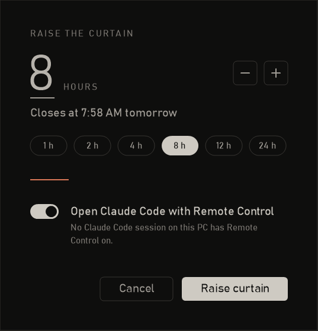
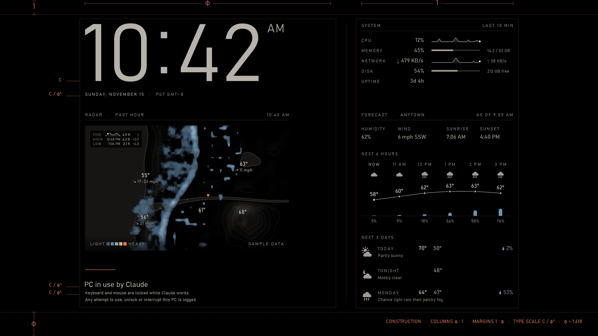
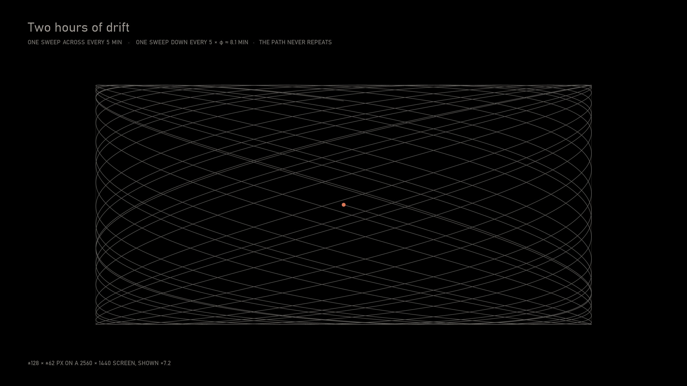

# Privacy curtain

A black screen that covers every monitor and blocks the physical keyboard and mouse, while automated
(injected) clicks, typing and screenshots keep working underneath. It's for hiding an automated session on
a machine you share a room with, without taking the machine away from yourself.

![The curtain on a 2560 × 1440 screen: a large clock with the date and time zone, and beside it the track now playing (a sample one) with its progress line; a radar and fog map of a made-up sample place below it (a coast, a river and a lake, its hills shaded and contoured, showers moving in from the west and a fog bank on the coast), with temperatures and wind, a tide table in one corner and the weather alerts in the other; under the map the message "PC in use by Claude" beside a close-up of the place's streets; and a data column with ten-minute CPU and network sparklines, memory and disk bars, then the forecast: the conditions now as small symbols (humidity, dew point, wind, sunrise and sunset), the next six hours as a temperature curve over rain-chance bars, and three days as small temperature and wind graphs](docs/curtain.png)

Awareness, not lockout: it counts and logs every blocked key press, click and escape attempt, can ping your
phone while someone is at the keyboard, and shows a "While you were away" summary when you unlock. The
screen itself is designed as carefully as the safety: see [Design](#design).

You raise it from a desktop shortcut, with a dialog in the same design: how many hours, when it will
close, and whether to open Claude Code with Remote Control first, so the PC stays reachable from your
phone while the screen is dark ([how to make the shortcut](#use)).



No installs, no administrator rights, nothing that survives a reboot. It compiles with the C# compiler that
already ships inside Windows (.NET Framework 4).

> **This is not a security tool.** It hides a screen and swallows stray input; it does not lock the machine.
> Read [Limitations](#limitations) before relying on it.

## Requirements

- Windows 10 version 2004 (build 19041) or later, or Windows 11. The capture-exclusion it relies on
  (`SetWindowDisplayAffinity(WDA_EXCLUDEFROMCAPTURE)`) needs that version.
- The in-box .NET Framework 4 compiler (`csc.exe` under `%WINDIR%\Microsoft.NET\Framework64\v4.0.30319`).
  Present on a normal Windows install. Nothing is downloaded or installed.

## Build

From the repository root:

```powershell
.\scripts\build.ps1            # produces bin\ClaudeCurtain.exe
.\scripts\build.ps1 -Tests     # also builds the test helper
```

`bin\` is build output and is gitignored.

## Use

```powershell
.\scripts\curtain-setpin.ps1              # once, at the PC: set the unlock PIN
.\scripts\curtain-on.ps1                  # 12 hours (the default)
.\scripts\curtain-on.ps1 -Hours 3
.\scripts\curtain-on.ps1 -Minutes 2       # handy for a first test
.\scripts\curtain-off.ps1                 # remote unlock (from another shell / remote session)
.\scripts\curtain-status.ps1 -Log 20
```

The curtain refuses to start until a PIN is set. The PIN is typed into a dialog on the PC's screen; only a
salted PBKDF2-HMAC-SHA256 hash is kept, in `local\pin.hash` (gitignored). A fresh random salt is generated
per machine the first time you set a PIN; nothing about the PIN is ever committed. Timer: default 12
hours, at most 24 (`-Hours 24` for a full day).

> **Tip: make a desktop shortcut.** Day to day, the easiest way in is a double-click. Run this once in
> PowerShell from the repository root:
>
> ```powershell
> $s = (New-Object -ComObject WScript.Shell).CreateShortcut("$([Environment]::GetFolderPath('Desktop'))\Privacy Curtain.lnk")
> $s.TargetPath = "$env:WINDIR\System32\WindowsPowerShell\v1.0\powershell.exe"
> $s.Arguments = "-NoProfile -ExecutionPolicy Bypass -WindowStyle Hidden -File `"$PWD\scripts\curtain-launch.ps1`""
> $s.WorkingDirectory = "$PWD"
> $s.IconLocation = "$PWD\bin\ClaudeCurtain.exe,0"   # the curtain's own icon: a closed curtain
> $s.Save()
> ```
>
> Or by hand: right-click the desktop > New > Shortcut, and paste
> `powershell.exe -NoProfile -ExecutionPolicy Bypass -WindowStyle Hidden -File "<repo>\scripts\curtain-launch.ps1"`.
>
> The shortcut opens a small dialog, drawn by the curtain itself in its own design: the hours as a large
> figure (prefilled 12, whole hours 1–24) with − and +, presets from 1 to 24 hours and the time the
> curtain will close, then a switch, *Open Claude Code with Remote Control*. On, and with
> [Claude Code](https://claude.com/claude-code) installed, it first starts a Remote Control session named
> `privacy-curtain` in Windows Terminal, so the PC stays reachable from your phone or another computer
> while the screen is dark (for example to run `curtain-off.ps1`). The switch starts off when a Claude
> Code session on this PC already has Remote Control on, however it was turned on (`claude
> --remote-control`, or `/remote-control` typed in a session), and the line under it says which, so
> launching the curtain again does not pile up windows. (It reads the small file Claude Code keeps for
> each running session in `~\.claude\sessions`.) Then it raises the curtain with no console window.
> Digits and the arrow keys set the hours, Tab moves, Space flips the switch, Enter raises, Esc cancels.
> Remote Control is best-effort: if it cannot start, the curtain still goes up.

## Ways back in

Any one of these is enough, and they do not depend on each other.

1. **PIN.** Type the digits, then Enter, on the physical keyboard. Backspace corrects, Esc clears. Five
   wrong tries in a row cost a 30-second pause, never more.
2. **`curtain-off.ps1`.** Asks the curtain to close, then kills the process if needed. A standalone script
   that loads nothing else, so it works even if the rest of the tool is broken.
3. **The timer.** Two independent clocks (wall time and system uptime); either one ends it. Time asleep
   counts.
4. **The watchdog.** A second process ends the curtain if it overruns its timer by a few seconds or stops
   responding.
5. **Ctrl+Alt+Del.** Never intercepted. From that screen: Sign out, or the power icon.
6. **The power button.** Not keyboard input, so it cannot be blocked. The curtain closes the instant Windows
   asks apps to end the session, on a listener that does not depend on its window thread, so it can't hold
   up a shutdown. (Set the button to *Shut down* under Power Options if you want a one-press exit.)
7. **Anything that ends the process.** The block exists only while `ClaudeCurtain.exe` is alive:
   `taskkill /F /IM ClaudeCurtain.exe`, a crash, or a reboot.

When anything looks wrong (a stuck thread, a lost watchdog, a hook error) the curtain closes itself. It
never changes sleep settings, Windows sign-in, the registry, or startup. The design rule throughout: being
open by mistake costs some privacy; being stuck closed would cost you the use of your own PC, so every
fault fails open.

## Staying awake and unlocked

While the curtain is up it holds a keep-awake request (`SetThreadExecutionState`: system + display). That
puts sleep, hibernate, display-off and the screen saver on hold, because any of them can end at the Windows
lock screen where the automated session can't work. It is a request held by the process, not a settings
change: it ends the moment the curtain closes or its process dies, and your normal settings apply again.

**Rest.** With no key pressed for 45 minutes since it went up (`--rest-minutes`, 0 = never), or for 20 since
the last key (`--wake-minutes`), the curtain rests to save energy: the map holds its latest picture instead
of replaying the hour, the accent rule stops breathing, the screen changes every 5 seconds instead of five
times a second, the weather script fetches the map every 15 minutes instead of 5 (and fresh pictures the
moment it wakes), and the monitor is switched off. A physical key press wakes it for 20 minutes; the mouse
and the automated session's own input never do, though they turn the monitor back on (Windows does that for
any input) until a minute passes with no input. The curtain switches the monitor off itself while still
holding its keep-awake request, so sleep and the screen saver stay off and cannot lead to the lock screen.
The key that wakes it is still blocked and counted, so it raises the input alert like any other.

It does **not** override two things that can still lock the machine behind the curtain. Check these
yourself before relying on it:

- **A machine inactivity limit** (the `InactivityTimeoutSecs` policy), if your organization sets one.
- **Dynamic Lock** (locks when a paired phone walks away), under Settings > Accounts > Sign-in options.

`curtain-on.ps1` also lists any administrator window that is open when it starts, because physical keys can
reach those behind the curtain (see [Limitations](#limitations)).

## Event log and "While you were away"

The curtain says on screen that attempts to use, unlock or interrupt the PC are logged, and
`local\events.log` (gitignored, capped at 1 MB, oldest part dropped) is that log. It is written on events
only, plus at most one line a minute. It holds counts, never PIN digits and never which keys were pressed.

```powershell
.\scripts\curtain-log.ps1                 # last 40 events
.\scripts\curtain-log.ps1 -NoHeartbeat -Summary
```

Recorded, each with a timestamp: start and stop (and how it stopped); wrong-PIN attempts as a count;
physical key/mouse use while blocked as counts per minute; the Windows security screen opening and closing;
Task Manager coming to the front and any administrator window taking focus; session lock/unlock and Remote
Desktop; network drops and returns; the process being killed; and, at the next start, an earlier curtain
that ended with no record (power cut, crash, kill).

On a PIN unlock a "While you were away" window shows how long you were gone (in the clock's tone, dimmed
overnight like the clock), a timeline of the session (short neutral ticks for minutes when someone was at
the keyboard or mouse, taller accent ticks for alerts such as a wrong PIN or the security screen), and the
totals as a table. It never takes focus and closes itself after 10 seconds. It sizes itself to its content
and the screen: a long summary first flows its table into more columns, then steps its text down, until it
fits. `curtain-off.ps1` prints the same summary as text.

 The closing time is not shown on
screen; `curtain-on.ps1` and `curtain-status.ps1` print it.

**How long logs are kept.** By size, not by date, so they can never grow past a fixed amount. All of
them together stay under about 1.8 MB, and the weather map's files under another 2 MB:

| File (in `local\`) | Cap | Roughly how much history |
|---|---|---|
| `events.log` | 1 MB, trimmed to the newest 600 KB | about 10 days of round-the-clock curtain, far longer with normal use |
| `curtain.log` (diagnostics) | 512 KB, trimmed to the newest 128 KB | weeks |
| `alerts.log` | 256 KB, trimmed to the newest 160 KB | thousands of alerts |
| `last-summary.txt`, `last-summary-timeline.txt`, `last-exit.json`, `weather.txt`, `weather-hourly.txt` | one small file each, overwritten (the timeline holds at most 5,000 moments, about 60 KB) | the last run only |
| `map.txt`, `map-base-*.png`, `map-water-*.png`, `map-waterfine-*.png`, `map-marsh-*.png`, `map-streams-*.png`, `radar-*.png`, `sat-*.jpg` (the weather map) | the last hour of pictures (about 8 radar, 7 satellite), one land and water map and one of rivers and lakes; older pictures are deleted at each refresh | the last hour |
| `dem-*.png`, `tide-station.txt` (the map's relief and tide) | the elevation tiles over the map's area (about 7 MB) and one line naming the tide station, fetched once per place; tiles for another place are deleted | as long as the place stays the same |
| `test\report-*.txt` | the 10 newest are kept | the last 10 test runs |

Your own unlock is not counted as someone at the keyboard. The key presses of the PIN entry that unlocked
(its digits, any Backspace corrections, and Enter) are left out of every count: the summary, the event log
and the "all clear" alert. That also keeps the PIN's length out of them. So is a key pressed just before the
PIN to wake the screen, as at Windows' lock screen: one key pressed with nothing typed, at most 10 seconds
before the PIN's first digit. Wrong attempts still count.

## Alerts (optional)

The curtain can make interference *visible* without blocking anything. It sends an alert through an
external notify hook (a PowerShell script you point it at, for example one that pushes to your phone), on
top of the event-log line, and records it in `local\alerts.log`, when:

- **someone uses the blocked keyboard or mouse.** The alert says how many key presses and clicks were
  blocked in the last minute (counts only, never which keys). Sustained use pings again each minute.
- **the Windows security screen opens** (Ctrl+Alt+Del, the lock screen or an administrator prompt).
- **Task Manager comes to the front**, or **an administrator window takes focus**.

Details:

- The hook is optional. With none configured, alerts are logged only. Point it at your own script with
  `--notify-hook` (the default looks for `%USERPROFILE%\.claude\hooks\notify.ps1` and is skipped if absent).
- Repeat alerts of the same kind within 30 seconds collapse into one; the event log still counts every
  repeat. One "all clear" with the totals is sent when the curtain closes cleanly (PIN, `curtain-off`,
  timer, Windows shutdown). After the security screen closes, the curtain re-asserts itself to
  the foreground (without stealing focus) so the black screen returns on top.
- Nothing here blocks or changes anything; a failed alert never affects the curtain.

## Design

A screen that stays up for hours in a shared room should be calm, legible from across it, and honest
about what it is doing. Everything on it comes from one proportional system built on the golden ratio,
φ ≈ 1.618, and the curtain can draw that system on top of itself:



- **Grid.** On a landscape screen the composition is two columns in the ratio φ : 1: the time, the
  weather map and the message on the left, live data on the right, a hairline between them. Both columns share a top edge
  (the data column's first label sits level with the top of the digits) and a bottom edge (the message's
  last line sits level with the forecast's last line), so the clock heads the page, the message anchors
  it, and typed PIN dots appear in the open space between. Beside the map, the forecast's header shares the
  map's header line, so the weather starts at one height across the page. On a portrait screen the data
  moves under the message. The composition rests on the golden section of the screen: the space above it and below it
  are 1 : φ. It takes at most 90% of the screen's width and 94% of its height; the rest is room for the
  drift.
- **A fixed frame.** Every slot is sized for the widest value it can ever hold (CPU "100%", a network
  rate of "999.9 KB/s", the widest time the clock's digits can make, "WEDNESDAY", "−99°"), and the image
  size comes from the grid, never from the ink. Changing numbers therefore never resize or move the
  composition; the self-tests prove it by laying out wildly different readings, times and forecasts and
  requiring the same frame to the pixel.
- **Type.** One family, Bahnschrift, a DIN design that ships with Windows, from Light for the clock to
  Regular for data. Every size is C, the scale's base, divided by a power of φ, and every gap is a step
  on the same scale; the clock itself is C/√φ, half a step down, so the map gets the room. Large type is aligned by its ink rather than its side bearing, the colon is lifted to the
  optical centre of the digits, AM/PM hangs small at cap height, and small capitals are letter-spaced.
  Forecast text is set in sentence case. The message is set small (its title C/φ⁵, its two lines C/φ⁶,
  the accent rule nearer the title than the map), so the map gets the height.
- **Data.** CPU, GPU and download rate are ten-minute sparklines with the newest reading at the right and a
  dot on it, and so is memory; disk is a proportion bar. CPU, GPU and memory are drawn on a fixed 0–100%
  scale, so a quiet machine looks quiet. The six rows share the height five would take at the table's
  usual spacing, so the GPU's row moves nothing below the table. Every value is also printed as text beside its graphic, so nothing depends on reading a
  chart. The forecast opens with the conditions now as a row of symbols, each with its value and no words:
  the humidity by a drop filled to its level, the dew point by a thermometer and a drop, the wind's speed by
  an arrow on a ring pointing the way it blows, as on the map (the ring alone when calm, amber from 20 mph),
  and the next sunrise and sunset by a sun on the horizon with an arrow up or down. They spread evenly
  across the column; the dew point joins only where all five fit, and the column never widens for it.
  Then the next six hours as a strip: each hour's symbol, its temperature on one smooth curve
  (drawn on at least a 6° range, so a flat afternoon looks flat), and its chance of rain as a bar. Then
  three days. Each day also shows its peak wind: the strongest sustained speed, and under it the hour it peaks and the strongest gust, from the hourly wind and gust series in the forecast grid's raw data (today counts from now, tonight until 6 AM). It turns amber from 20 mph, or gusts from 30. It takes only the room between the low and the rain, so it never moves anything. Each row is two small graphs drawn like the system's sparklines, from the forecast grid's hours that the weather script adds to the row: the temperature from 6 AM to 6 AM (tonight's from its start, on the same clock, ticks at noon and midnight) with the high marked and "low–high" beside it, and the wind over the same hours with its peak marked and its peak and strongest gust ("8–14 mph"), amber from 20 mph or gusts of 30; one scale serves all three rows, so a warmer or windier day stands out. The words and the chance of rain take the second line; day names are short. A row without its hours shows symbols instead: a small triangle up for the high and down for the low, each with the hour it comes, the wind symbol before the peak wind, and a pennant before the strongest gust. Rain is the one cool data hue, a muted steel blue. Weather symbols are drawn in code (sun,
  moon, cloud, partly cloudy, rain, storm, snow, fog, wind).
- **The weather map.** Under the date, as wide as the clock, with a header ruled like the data column's
  sections ("RADAR · PAST HOUR", the picture's time at the right). On a landscape screen the data column
  decides where the message sits, so the map fills space that was empty and moves nothing else; its header
  shares a line with the forecast's, which gives it the room the forecast takes below that line, and the
  composition takes all the height it may, the forecast's chart and gaps stretching by as much. It shows
  135 km top to bottom, as a golden rectangle where the screen has room for one, with home as a small
  accent-coloured dot on the golden section across and 7/10 of the way down, so the larger parts of the
  map lie to the west, where weather usually comes from, and to the north. It is drawn
  in the curtain's own palette rather than the services' colours: water a deep navy, the shoreline a fine
  cool slate line drawn over the weather so the coast stays readable under fog, rain in
  the data hue from quiet to bright as it gets heavier (amber when heavy, coral when severe, with a
  five-step legend), clouds and fog in warm white, never brighter than the body text, so the clock stays
  the brightest thing on screen. Under the weather the land's relief stays ground rather than picture: lit
  slopes, a faint warm tint on high ground and hairline contours every 100 m, with a stronger one every
  500 m, like a topographic print. The water includes the rivers, canals, lakes and reservoirs, not only
  the coast. Marshes and seasonal wetlands are drawn as on a topographic print, the ground a step toward the
  water's tone with rows of short staggered dashes, and the creeks (from stream order 2 up; order 1, every
  gully, would be a scribble) as fine lines, stronger for bigger streams, so they never read as contours: a
  clear blue where they flow all year (perennial streams, canals and ditches) and a dim grey-blue where they
  are seasonal (intermittent or ephemeral), with the marsh dashes a blue slate between the two, so bay,
  delta, marsh and creeks read as one family of water, all darker or greyer than the rain.
  Over it, a few labels with a dark halo: station temperatures spread across the map, and wind only where
  it is notable. The tide has a small table in one of the top corners, set a half step under the map's
  other labels so it hides little of the map, with what a fisherman or a surfer looks for:
  "TIDE" with the day's curve (now a bright dot on it), the height now and an arrow for rising
  or falling; then the next low and high with their times, heights and the change from the high or low
  before ("−6.1": the water drops 6.1 ft). It takes the top corner that hides fewer temperatures; on a tie
  the one over more water (the tide's own element, with no towns or hills to hide), then the east one, where
  the weather has already gone by. The PIN row shares the map's lowest band: while a PIN is typed the map fades to black, and it
  comes back when the row clears.
- **Colour.** Warm neutrals in four text tones and one accent, the short terracotta rule. The self-tests
  compute each tone's contrast on black: every text tone meets WCAG AA (the faintest labels are 4.9 : 1)
  and body text and values meet AAA (7.7 : 1). The clock has its own tone, a step under the brightest,
  which is kept for "now" (the PIN dots, the charts' latest points): at its size the brightest would glare.
  Overnight (10:30 PM to 6:30 AM, with hour-long ramps) the clock dims to 70% so it glows less in a dark
  room, and still meets AA (5.1 : 1); AM/PM never outshines the digits.
- **Motion.** The composition is rendered once into an image, again only when something on it changes
  (about 30 to 50 ms), and moved as one rigid piece a whole pixel at a time, so lines never shimmer
  against each other. It fades in when the curtain rises and cross-fades when the minute turns. The
  accent rule breathes slowly while the curtain is up, a quiet sign that the PC is at work. Typed PIN dots
  ease in, and a wrong PIN shakes them before they fade and the note appears. The map plays its past
  hour on a loop, a picture every 0.7 s, each fading gradually into the next through the whole step
  (eased, so each picture is whole for a moment), holding the latest for two steps, while a short mark
  runs along its header's rule. The two pictures of a fade, and the fog under them, are blended pixel by
  pixel into one picture and drawn once (about 4 ms), so what they share never thins mid-fade. The screen
  repaints at about 60 frames a second only while one of the short animations plays, just the map's part
  about 25 times a second while only the loop moves, and five times a second otherwise.
- **Drift.** Against burn-in, the composition wanders within 5% of its resting point: one sweep across
  every 5 minutes and one sweep down every 5 × φ ≈ 8.1 minutes. Because φ is irrational the path never
  repeats, so over the hours it covers its area evenly instead of retracing one figure:



The curtain hides itself from screenshots by design, so every image here is rendered by the curtain's own
preview mode:

```powershell
.\bin\ClaudeCurtain.exe --render-preview "$env:TEMP\curtain.png" --test-screen 2560x1440 --test-state typing
.\bin\ClaudeCurtain.exe --render-preview "$env:TEMP\construction.png" --overlay
.\bin\ClaudeCurtain.exe --render-preview "$env:TEMP\summary.png" --test-state summary
.\bin\ClaudeCurtain.exe --render-preview "$env:TEMP\launch.png" --test-state launch
.\bin\ClaudeCurtain.exe --render-drift "$env:TEMP\drift.png"
```

`--test-state` is one of idle, typing, wrong, shake, cooldown, admin, bright, night, summary, launch, radar or
clouds to force the map's mode, or music, paused or music-long for a sample track; several combine with commas
(`radar,music`). `--preview-seconds N` shows the drift position N seconds in. With
`--local-dir` pointing at a folder that has a `map.txt`, the preview uses that real map, at the real time
and with the real hourly forecast; otherwise it draws a made-up sample place (a coast, a river and a lake),
which is what every image here shows (the first rendered with `--test-state radar,music` and an empty
`--local-dir`). To share a picture of your own map, add `--hide-home`: it leaves the home dot off and
centres the map on your place rounded to a tenth of a degree, not on the place itself. The picture still
shows your area, its streets in the close-up, and the place name from your config, so share one only if
you are comfortable with people knowing your town.

## On-screen info

The data column:

- **Machine stats**, live from inside the curtain (sampled once a second, no admin): CPU busy %, GPU busy %
  and the graphics card's own memory in use, memory used, download and upload rates, used share of the
  system drive, and system uptime, with ten minutes of history kept in memory for the sparklines. Only the
  GPU uses performance counters: Windows' GPU Engine counters, read as Task Manager does (each engine's
  processes added up; the busiest engine is the GPU's figure), on a thread of their own so a slow read never
  holds up the PIN keys. The card's memory size comes from its driver's registry entry.
- **The local forecast.** Humidity, dew point, wind, the next sunrise and sunset, the next six hours, and
  three days with each day's peak wind and gusts.
  Set your location in `config.json` (copy `config.example.json`):

  ```json
  { "grid": "ABC/12,34", "place": "Your City", "wuApiKey": "" }
  ```

  Find your `grid` at `https://api.weather.gov/points/<lat>,<lon>` (read `gridId`, `gridX`, `gridY`).
  `curtain-weather.ps1` then writes three days to `local\weather.txt` and the next twelve hours (with
  humidity, wind, dew point and the forecast grid's location) to `local\weather-hourly.txt`; the curtain reads both
  and refreshes whenever they change. `curtain-on.ps1` starts it in the background with the curtain's
  process ID: it refreshes every 30 minutes while that curtain is up, so a 12- or 24-hour session always
  shows the hours actually ahead, and exits when the curtain closes. The curtain process itself never
  touches the network. Sunrise and sunset are worked out on the PC from the grid's coordinates with NOAA's
  solar equations, accurate to about a minute. You can also run the fetch any time:

  ```powershell
  .\scripts\curtain-weather.ps1
  ```

  The source is the US National Weather Service (`api.weather.gov`): keyless, no account, no install. It is
  best-effort: a lost network shows no forecast rather than an error, and anything older than a day is
  dropped. The User-Agent sent to NWS is a generic client name. Weather Underground's forecast API now needs
  a paid key, so it is not the default; `config.json` has a `wuApiKey` slot for where one would go.

And in the left column:

- **Now playing.** What Spotify (or a browser, or any player that reports to Windows' media controls, the
  panel by the volume flyout) is playing, right of the clock and flush with the map's right edge, so it
  mirrors the clock: "NOW PLAYING · SPOTIFY" (or "PAUSED"), the title, the artist on the clock's baseline
  (with the album when there is room), and on the date's baseline the elapsed time, a thin progress line
  and the length. It is read once a second on a thread of its own, through the Windows Runtime API
  `GlobalSystemMediaTransportControlsSessionManager` (Windows 10 1809 or later), compiled against the
  `.winmd` metadata in `System32\WinMetadata` that every Windows has, so nothing is installed. Apps report
  the position only on play, pause and seek, so the line runs on from the last report. The still part is
  redrawn only when the track changes; the line and the elapsed time are drawn live, five times a second. A
  title too long to fit drops trailing extras first ("(feat. ...)", "[Live]", "- Remastered 2011"), then
  ends in an ellipsis. Nothing shows when nothing plays, when a track has been paused for 15 minutes, or on
  a portrait screen, where the clock leaves no room beside it. Previews show the real track (not with
  `--hide-home`), or a sample one with `--test-state music`, `paused` or `music-long`, which combine with
  the map's mode (`--test-state radar,music`).
- **The weather map.** Radar when rain is near, clouds and fog otherwise. *Radar* shows when the next three
  hours of the hourly forecast have a 30% chance of rain or more, or rain, showers, storms or snow in their
  words, or when the radar shows at least light rain (20 dBZ) within 50 km. The source is NOAA's MRMS
  mosaic through NOAA nowCOAST: every radar that covers the area blended at 1 km and cleaned of ground
  clutter, new about every 4 minutes. The curtain reads the exact rain rate (dBZ) back out of NOAA's
  colours (a self-test round-trips every value) and draws it in its own, smoothed: interpolated with a
  cubic curve that passes through each cell's own value, so smoothing never moves rain, then blurred by
  about a quarter of a cell, so the rain's edge is a curve rather than steps. *Fog* shows in either mode,
  as a soft veil under the radar or the clouds: NOAA's GOES-West fog and low stratus product (the chance
  of fog or cloud low enough for instrument flight rules, from the satellite and a weather model, day
  and night) from SSEC RealEarth, whose web-map tiles the weather script stitches over the box every 10
  minutes. The curtain reads its colours back as percentages, smooths its 10 km cells, and shows nothing
  below 30%, a veil at most 0.30 thick above it, each weather picture with the fog of its own moment;
  the header then adds FOG. *Clouds* are NOAA's GOES
  satellite pictures through nowCOAST, every 5 minutes: visible by day (half-kilometre detail, enough to
  watch coastal fog move; evened out when the sun is low), infrared at night (it shows cloud, but fog and
  low stratus are close to the ground's temperature, so they barely show at night). Land and water come
  from NASA GIBS's map made from OpenStreetMap, fetched once (map data © OpenStreetMap contributors),
  with the rivers, canals, lakes, reservoirs and estuaries of the USGS National Hydrography Dataset added,
  from its map service, fetched once per place: a request for the same rounded box, drawn as plain fill
  without the service's outlines, names or ponds under 0.05 km². Its swamps, marshes and inundation areas,
  and its streams and ditches from Strahler order 2 up, come the same way, as two more masks on the same
  grid (`map-marsh-*.png`, `map-streams-*.png`; the stream order in the red channel, year-round flow in the green).
  The 1:100,000 data lacks some reservoirs, so the water also comes from the high-resolution hydrography
  (`map-waterfine-*.png`; its large-scale layers, asked at 4 dpi so the server draws them for a picture this
  wide), added to the rest, so either source only ever adds water. It covers the United
  States.

  Warnings and earthquakes: the National Weather Service's active alerts for the state whose areas reach
  the map are drawn as a fine outline with the faintest wash, coral for a warning and amber for a watch
  or an advisory (surf, wind, air quality, flood, fire, tornado; outlooks and statements left out). Most
  alerts name forecast zones, whose outlines the weather script fetches once and keeps for 30 days
  (`local\zone-*.txt`). Earthquakes of magnitude 2.5 and up over the last three days, from the USGS feed,
  are rings sized by magnitude that fade with age. A small inset in the top corner the tide leaves lists
  up to four: warnings, then earthquakes (from M3 on the map in the last day, from M4 within 300 km in the
  last three days, with how far (in miles, like the curtain's mph and feet) and which way when off the
  map), then watches and advisories, each with
  when it ends.

  The close-up: on a landscape screen, in the room beside the message under the map, a map of the
  town around home, 7.5 km tall (about 35 m a pixel), reaching 2.9 km south of home and the rest north,
  home 7/10 of the way across (change `DetailViewKm`, `DetailSouthKm` and `DetailWestShare` in
  `WeatherMap.cs` to frame it differently). It plays the
  map's own radar or cloud pictures at the same moment of the loop, so the two always agree, the
  radar's 1 km cells softened by a third of a cell where blown up this far so showers come out round,
  and the fog's 10 km cells an even veil.
  Its own ground is fetched once per place: a box of 0.2 x 0.4 degrees around the place rounded to a
  tenth of a degree (more of it west), at about 12 m a pixel, with the land and water map, the
  hydrography's water and marsh and its high-resolution creek lines (canals and ditches drawn as
  seasonal: in a town they are mostly flood channels), the US Census Bureau's TIGER streets (public
  domain; local streets a faint weave, state routes and freeways a step lighter and drawn over water
  too, so bridges show) and zoom-13 elevation (about 15 m; at this scale the relief's exaggeration
  eases and contours come every 50 m). No label, alerts or stations: the ground, the weather and
  home. The ground is kept between refreshes while its files are unchanged. With the close-up shown,
  the map's block (header, rule, map) sits a φ⁴ step under the date instead of φ³, keeping its size,
  and the close-up takes the height that frees; the data column's first gap is φ⁴ too, so the
  forecast's header rises with the map's and the two stay on one line.

  Under the weather, the **relief**: the land's shape from AWS Terrain Tiles (in the United States, USGS
  3DEP elevation; about 120 m a cell at zoom 10, about 70 tiles, 7 MB, fetched once per place), sampled
  four times a screen pixel and softened by only a pixel, so ridges and valleys stay crisp. Hills are lit
  from the north-west, heights exaggerated 2.4 times so gentle ranges still read at this scale. Black can't
  be darkened, so lit slopes brighten and high ground takes a faint warm tint while valleys stay black. A
  hairline contour every 100 m and a stronger one every 500 m are drawn per pixel from height and slope
  (no tracing), so the lines stay smooth at any screen size; where a slope packs the 100 m lines closer
  than about three pixels they fade, so steep ground keeps only its 500 m lines.

  Over it, small labels with a dark halo so they read over cloud and rain:

  - **Temperatures and wind** from the latest reports of every airport weather station on the map (METARs
    from NOAA's Aviation Weather Center, one request for the area, at most every 15 minutes; reports more
    than 2 hours old are dropped). Up to seven are labelled: first the station nearest home, then each
    time the one farthest from those already chosen, so the labels spread across coast, shore and inland
    valleys, which is where local microclimates differ, and never crowd or overlap. Wind shows only where
    it blows 10 mph or more, as an arrow pointing the way it blows and "14 mph", or "14–20 mph" when it
    gusts well above that, so a windy coast stands out and calm places stay a plain number.
  - **The tide** at the nearest NOAA tide station that keeps its own predictions (a "reference" station)
    within 60 km, found once per place from NOAA's station list. Its predicted highs and lows (NOAA CO-OPS,
    refreshed every 6 hours) become the tide table: the height now (from the usual cosine curve between each
    high and low) with ↑ or ↓, then the next low and high with their times, heights and the change from the
    high or low before. Inland there is no station and no table.

  `curtain-weather.ps1` fetches all of this into `local\` alongside the forecast (`map.txt` lists the
  pictures, the station reports and the tide) and, in the background, refreshes it every 5 minutes
  (`-MapMinutes`), keeping only the last hour of pictures. The map's credit reads "NOAA · USGS ·
  Census · © OpenStreetMap" (Census with the close-up's streets); where a narrow map's credit would run into
  the legend, the public-domain sources drop out first and OpenStreetMap's always stays.
  Requests carry a box of 1.6 × 3.4 degrees around the forecast grid (0.6° south of it to 1.0° north),
  rounded to a tenth of a degree (about
  10 km), so the servers learn the area, never the address; no key, no account. Pictures more than three
  hours old are never shown, and with no map files at all the curtain looks exactly as it did before the
  map. `-NoMap` leaves it out. Like the forecast, it covers the United States.

Everything here is read-only and isolated: a failed reading shows `--`, and nothing in it can hold up the
curtain or a shutdown.

## Limitations

Please read these before relying on the curtain.

- **It is not a security boundary.** It is a personal privacy curtain: it hides the screen and swallows
  stray keyboard and mouse input from someone walking up. It does not lock the machine. To actually secure
  the PC, lock Windows.
- **The PIN is not a real lock.** It is a convenience for dismissing the curtain at the keyboard. It is only
  lightly rate-limited (a 30-second pause after five wrong tries) with no lasting lockout, so it will not
  withstand determined guessing. And anyone who can reach the running process can simply close it (Task
  Manager, `taskkill`, Ctrl+Alt+Del > Sign out, or the power button). That is deliberate, so you can never
  be locked out of your own machine.
- **Injected input is trusted.** The curtain blocks physical keyboard and mouse but deliberately lets
  *injected* (synthetic) input through, so an automation tool can keep driving the machine underneath. This
  means anyone or anything that can inject input — including remote-control software — operates the machine
  through the curtain. Treat the curtain as hiding a session you trust, not as walling one off.
- **Administrator windows.** Without admin rights, Windows hides input aimed at an elevated window (Task
  Manager, an admin shell) from the hooks, so physical keys reach that window. While one has focus the
  curtain says so and switches PIN entry to registered hotkeys. If the PIN seems dead, press the Windows key
  first.
  - *Hidden ones.* A background service can leave a helper running as SYSTEM with a window nobody can see
    holding keyboard focus (a game launcher's update once did this for an hour). When the elevated window in
    front cannot be seen (not visible, minimised, cloaked, 4 px or smaller, off every screen, or fully
    transparent), the curtain hands focus back to the last ordinary window that had it, or to the taskbar.
    Windows refuses such a switch from a background process until 200 s pass with no input, unless that
    process sent the latest input itself, so the curtain first sends a zero-pixel mouse move (nothing moves)
    and tries straight after; then it retries every 2 s without the nudge, so it never keeps resetting those
    200 s. A visible elevated window is left alone, and if a hidden one takes focus straight back, the
    curtain stops fighting it. `curtain.log` says which way it went.
  - *What the log keeps.* The elevated window is described by process, window class, place and size (no
    title). The hotkey fallback logs the first key that reaches it, whether any did when it switches off,
    and when the PIN came in through it; never how many keys, which would give away the PIN's length.
- **Things Windows draws above every app** can show over the curtain: toast notifications, the Start menu,
  Alt+Tab, the volume popup. Turn on Focus Assist if toasts matter. The mouse pointer also stays visible.
- **Games.** Apps that read raw input (most games) and game controllers are not blocked. Not tested with
  exclusive-fullscreen games.

## Tests

```powershell
.\scripts\test-curtain.ps1            # lifecycle, works while locked
.\scripts\test-curtain.ps1 -Desktop   # screenshots and injected input; run with the PC unlocked
```

They use a throwaway PIN in `local\test` and never touch the real one, and they never call your notify
hook. How much to run follows what changed (since 2026-11-21): a change to what is drawn or to the weather data gets the self-tests, preview renders and the `smoke` and `off` stages (a real curtain up and down); the full lifecycle and desktop suites run when input, the PIN, the lifecycle or anything security-related changes, since they prove the curtain can never trap anyone. The self-tests (~165 checks, including PIN hashing/entry rules, which key presses belong to your own
unlock, the time-zone label, the stats sampler, weather-file reading, and the design: every state rendered
at 720p, 1080p, 16:10, 1440p, ultrawide and portrait, fitting the screen, the columns exactly φ : 1, the
forecast's header on the map's line,
staying on screen through 8 hours of drift, a fixed frame whatever the readings, the hourly forecast file,
sunrise and sunset against published times, every text tone's WCAG contrast, and the animations starting
and settling; and the weather map: its place in the layout, every radar colour read back as its dBZ, the
map file and its pictures, stale and missing pictures, radar or clouds, which part of the area shows, the
replay's timing, the sun's height, the replay and the PIN veil letting the screen rest, station reports,
elevation tiles decoded and stitched in the right places, the tide curve through each high and low, which
stations get a label, labels never overlapping, the relief being drawn, the tide table's corner (over the
water on a tie) and its rows, and `--hide-home` leaving home off the map; and now playing: times, app names, the position running on
between reports, its place beside the clock on every screen, shortened titles, and a live read of Windows'
media controls) and the full
lifecycle suite (100+ checks: a screenshot seeing the
desktop through the curtain, injected clicks and typing passing through, simulated shutdown, every hang
being recovered, the keep-awake request appearing with the curtain and vanishing with it, the alerts, the
re-assert, the event log/summary, the summary window laid out at 720p, 1080p and 1440p with nothing
clipped, and the launcher: which Claude Code sessions count, a session that has ended or whose process id was
reused not counting, how its Remote Control switch starts, and its dialog answering through its file) both pass. The desktop stage `admin-focus` treats a test
window as elevated (`--test-elevated-title`, since a real one needs an administrator prompt): a window
that takes focus and then shrinks to 1 x 1 px off screen loses it again within half a second; a visible
one keeps it; and a PIN typed through the hotkey fallback is refused when wrong and accepted when right,
without the digits reaching the window in front. The on-screen info
panel and real physical key presses are not script-testable (the curtain is excluded from screen capture by
design); a person-at-the-PC checklist is in the lifecycle test's output.

`-Stage display-off` is a stronger keep-awake proof kept out of the default run, because it changes a
display-timeout setting for about two minutes and then restores it. Nobody should touch the PC while it
runs.

## Layout

- `src/` — C# source, compiled by `scripts/build.ps1` with the in-box Windows `csc.exe` into `bin/`
  (ignored).
- `scripts/` — the PowerShell entry points (on, off, launch, set-pin, status, log, weather, build, test).
- `tests/` — the test helper used by `test-curtain.ps1`.
- `local/` (ignored) — the PIN hash, logs, run state, the cached forecast and the weather map's pictures,
  elevation tiles and tide station.

## Colophon

Set in Bahnschrift (Microsoft, after DIN 1451). Grid, type scale, margins and drift all derive from the
golden ratio. Drawn with GDI+ from the C# compiler inside Windows, with no external assets: the weather
symbols, sparklines and bars are all code, and the map is drawn pixel by pixel from NOAA's radar,
satellite, station and tide numbers, over relief from USGS elevation (AWS Terrain Tiles), a land and
water map from NASA GIBS (© OpenStreetMap contributors), the USGS National Hydrography Dataset, the US Census Bureau's TIGER streets
and, for the fog, NOAA's GOES-West fog and low stratus product (Source: SSEC RealEarth, UW-Madison). Designed, built and tested with
[Claude Code](https://claude.com/claude-code).

## License

MIT. See [LICENSE](LICENSE).
